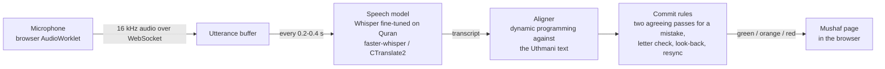

# Quran Recitation Tracker

**Recite the Quran out loud and see every word checked as you go, on the page of the Madani mushaf, fully offline on your own PC.**

The tracker listens through the microphone, follows your position word by word and colours each word:
green when it was recited correctly, orange when it is probably a mistake, red for a wrong or skipped word.
It is built for memorisation (hifz) practice: the next words stay hidden until you recite them, and you can ask
for a hint, reveal a word or an ayah, retry an ayah or restart the whole range.

Your voice never leaves the computer. Speech recognition runs locally on the processor or, faster, on an NVIDIA GPU.

---

## Features

- **Live word-by-word tracking** on the 604 pages of the Madani mushaf (one or two pages side by side).
- **Mistake detection**: wrong words, skipped words, extra words, and a letter check that catches commonly confused
  letters (for example ح/ه, ع/ء, ق/ك, ص/س, ط/ت, ذ/ز) even when the speech model wrote the word correctly.
- **Memorisation mode**: the text appears as you recite it; *Hint*, *Reveal word*, *Reveal ayah*, *Retry ayah*,
  *Restart range*. Click an orange or red word to see what was heard.
- **Practice ranges** by surah and ayahs, by page, or by juz / hizb.
- **Find an ayah by voice**: recite a few words and jump straight to that place.
- **Handles real recitation**: a spoken basmala at the start of a surah, the letter openings (الٓمٓ ...),
  connected speech across words (hamzat al-wasl), restarts and going back to repeat an ayah.
- **Offline and private**: one-click Windows packages that install without internet.

## Download and run (Windows 10/11, 64-bit)

1. Open the [**Releases**](../../releases) page and download one zip:
   - `QuranTracker-<version>-gpu.zip` for a PC with an NVIDIA graphics card (faster), or
   - `QuranTracker-<version>-cpu.zip` for any other PC (smaller; works everywhere).
2. Extract the **whole** folder to a short path such as `C:\QuranTracker`.
3. Double-click **`Start.bat`**. The first start sets everything up from the included files
   (a few minutes, no internet needed); later starts are quick.
4. The app opens in your browser (Chrome or Edge). Allow the microphone and start reciting.

Keep the black window open while you use the app; close it to stop. If something goes wrong, the `logs` folder
next to `Start.bat` has the details.

## How it works



- Whisper is not a streaming model, so the server re-transcribes the growing utterance several times per second.
  Correct words are painted at once; a mistake is only painted when two passes agree on it and a correct word
  follows, so half-heard words are not flagged. A pause ends the utterance with a final, beam-searched pass.
- The aligner matches the transcript against the canonical text with tolerance for the speech model's quirks
  (weak letters, split or fused words, connected speech).
- The **letter check** re-scores a word that looks correct with the speech model itself (forced decoding),
  swapping one commonly confused letter at a time; if a swapped reading fits the audio clearly better, the word
  turns orange.
- The words recited just before an utterance are given to the model as a context prompt.

## Accuracy

Measured with the project's benchmark (`backend/bench.py`) on 240 recorded sessions: 1,508 words recited
correctly and 46 deliberate mistakes.

| | Result |
|---|---|
| Correctly recited words shown green | **97.6 %** |
| Deliberate mistakes caught (orange or red) | **23 of 46** |
| Speech model time per pass (GPU, median / 95th percentile) | 107 ms / 335 ms |

The main limit is the speech model: it was trained on correct recitation, so for about half of the deliberate
mistakes it writes the correct word anyway. A pronunciation (letter-level) checking model is the planned next step.

## Project layout

| Path | What |
|---|---|
| `client-web/index.html` | the whole web app (mushaf pages, microphone, colours, memorisation tools) |
| `backend/server.py` | FastAPI WebSocket server: audio -> speech model -> alignment -> commit rules |
| `backend/alignment.py` | word alignment against the Quran text |
| `backend/ayah_finder.py`, `basmala.py`, `muqattaat.py`, `mushaf.py`, `cudaprep.py` | find by voice, basmala, letter openings, page layout, GPU detection |
| `backend/quran.db` | Quran text and Madani page/line layout (`build_db.py` rebuilds it) |
| `backend/kit/` | Windows release package: launcher, notices, `fetch_offline.py`, `make_package.py` |
| `backend/bench.py`, `replay.py`, `passdiff.py`, `bench_labels.json` | benchmark and regression gate |
| `backend/sim_live.py`, `tape_*.py`, `lettercheck_probe.py`, `*_eval.py` | analysis tools |
| `backend/train*.py`, `ct2conv.py`, `record_server.py` | model training and data recording |
| `scripts/release.ps1` | publish a new GitHub release |

## Development

Requirements: Windows, Python 3.12 (64-bit); an NVIDIA GPU is optional.

```powershell
pip install -r backend\kit\requirements.lock.txt
pip install -r backend\kit\requirements-cuda.txt     # only with an NVIDIA GPU
```

The speech model is not stored in git. Take the `app\backend\model` folder from a release zip and copy it to
`backend\model` (or point `CT2_DIR` at any CTranslate2 model folder). Then:

```powershell
cd backend
uvicorn server:app          # open http://localhost:8000/
```

The code defaults are the production settings. Useful environment variables: `HW_DEVICE=cpu` (force the processor),
`SILENCE_RMS` (raise it if room noise keeps utterances from ending), `TAPE=1` (record sessions to `backend\tapes`
for replay; recordings never leave the PC and are excluded from git).

### Testing a change

Stop the server first (the benchmark uses the GPU). It needs recorded sessions, which are local only.

```powershell
cd backend
python bench.py NAME [--asr] [--set KEY=VALUE]     # score card: false flags, mistakes caught, speed
python bench.py --compare prod_asr NAME             # every word that changed
python passdiff.py prod_asr NAME                    # strict: every pass identical (for clean-ups)
```

A change is kept only if no line of the score card gets worse.

## Releasing

```powershell
cd backend
python kit\fetch_offline.py                         # once: Python, VC++ runtime and wheels -> kit\offline_cache
cd ..
.\scripts\release.ps1 -Version 0.2.0                # build both zips, tag, publish the GitHub release
```

See `scripts/release.ps1` for what it checks before publishing.

## Privacy

Audio is processed in memory on your computer. Nothing is uploaded, and the app needs no account and no internet
connection. Session recording (`TAPE=1`) is a developer option and is off by default.

## Credits

- Speech model derived from [tarteel-ai/whisper-base-ar-quran](https://huggingface.co/tarteel-ai/whisper-base-ar-quran)
  (Apache 2.0), itself a fine-tune of [OpenAI Whisper](https://github.com/openai/whisper); further fine-tuned for
  this project.
- Quran text and page layout from [zonetecde/mushaf-layout](https://github.com/zonetecde/mushaf-layout).
- Built on [faster-whisper](https://github.com/SYSTRAN/faster-whisper), [CTranslate2](https://github.com/OpenNMT/CTranslate2)
  and [FastAPI](https://fastapi.tiangolo.com/).

Full third-party notices: [`backend/THIRD_PARTY_NOTICES.txt`](backend/THIRD_PARTY_NOTICES.txt).

## License

No license has been chosen for this project's own code yet; all rights reserved.
